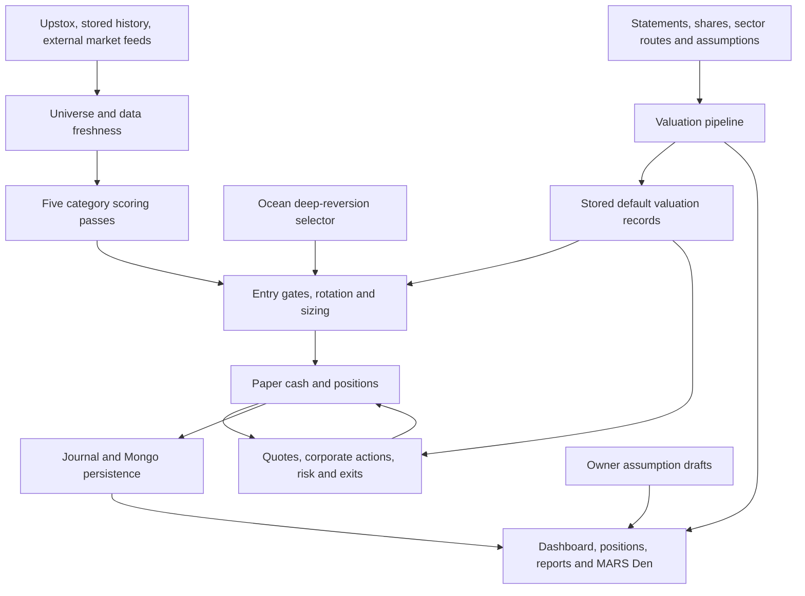

> Historical audit snapshot, 30 October 2026. Findings and line numbers describe that baseline. See [current repair status](../README.md) for subsequent fixes.

# MARS repository review — 30 October 2026

**Reviewed source:** [MARS main at bdc82ec7039ccad151f45674ae253c6db6672751](https://github.com/damandamanaulakh-tech/MARS/tree/bdc82ec7039ccad151f45674ae253c6db6672751). The latest main commit is dated 22 October 2026, 11:54 IST. This is a source, data, tests, documentation and operations review; it is not a certification of investment performance or a live-account audit.

**Assessment:** MARS is a substantial NSE cash-equity paper-trading and research application. It implements much more than a dashboard: five category scans, a separate Ocean selector, sizing and portfolio controls, paper orders, exits, valuation, market data, scheduled refreshes, reports, and a detailed decision journal. Several important safety mechanisms nevertheless fail under missing data, partial quotes, refused writes or concurrent manual actions. Many corrections exist only in unmerged draft PR #186, and several independently reproduced problems remain even there.

## Start with these deliverables

- [Every one of the original 47 task-book points, reconciled to current code](47_POINT_CHECKLIST.md).
- [Detailed trading logic, formulas, defaults and findings](TRADING_REVIEW.md).
- [Detailed web, persistence, authentication and scheduling review](WEB_AND_OPERATIONS.md).
- [Research, documentation, reproducibility and intake findings](RESEARCH_AND_DOCUMENTATION.md).
- [All 929 tracked files and the Python module catalog](FILE_CATALOG.md).
- [GitHub branches, CI, PR and release state](GITHUB_STATE.md).
- [File hashes and parser results](file-inventory.csv), [archive member inventory](archive-members.csv), [all archive CSV profiles](archive-data-profiles.csv), and [all 240 release assets](release-assets.csv).

The local source checkout used for examination is `historical isolated review checkout`. The user's original workspace remains at `historical local workspace`; this review writes its deliverables under `review-2026-10-30`. No source fixes, commits, pushes, merges, deployments, production scheduler jobs, broker logins or trades were performed.

## Repository state and coverage

| Item | Verified result |
|---|---|
| Main revision | `bdc82ec7039ccad151f45674ae253c6db6672751` |
| History | Full clone, not shallow; 285 commits reachable from main |
| Main tracked tree | 929 files; 201,760,163 bytes, approximately 202 MB |
| Python | 403 files parsed successfully with Python AST; 223 `test_*.py` modules |
| Main folders | data 290 files; docs 61; research 129; scripts 31; trading 219; web 192; 7 other tracked files |
| CSV/gzip outside archives | 170 files; all 4,076,215 data rows parsed |
| ZIP-format containers | 8 containers, including 4 data ZIPs, 3 XLSX workbooks and 1 NPZ; 3,425 members; all CRC checks passed |
| CSVs inside the 4 data ZIPs | 3,385 members; all 3,719,150 data rows parsed |
| Workbooks | All sheets and populated cells traversed; formula cells inventoried, not recalculated by a spreadsheet application |
| GitHub release | One release, 240 assets, 1,711,553,983 bytes; metadata inventoried, contents not downloaded or read |
| Other active development | Draft PR #186: 5 commits ahead, 0 behind, 51 changed files, +4,579/-371 lines |
| Old port branch | `port/stock-session-round1` has no exclusive commits; main is 282 commits ahead |

Mechanical parsing and hashing do not imply that every value is correct. Deep review concentrated on executable trading, money mutation, persistence, scheduling, valuation and research-intake paths. All production module interfaces and current documentation areas were inventoried. Large historical catalogs, every old prose statement, and every historical experiment were not independently re-proven. The 5,640-line CLAUDE chronology was used selectively as historical context. The coverage ledger explicitly identifies deep versus targeted trading review.

## What the application actually does

The principal automatic entry selector remains momentum/composite scoring. Valuation records can now change **exit targets**. Valuation-first entry permission is a proposed architecture, not the current entry rule. The Den's editable assumption drafts are designed to affect display calculations, while the exit-record builder uses the defined tested/default rule.

The broker client provides authentication, instruments, quotes, candles, account readings and other market data. The reviewed implementation has no live broker order-submission path. Paper-only operation is established by those actual call paths. The `PAPER_ONLY` guard helper has no production caller, so the README overstates what that helper itself enforces.

## Main component map

| Area | Implemented responsibility | Important limit |
|---|---|---|
| Universe/history | Public instrument master, stored history, liquidity ranking, custom lists, weekly rebuild and universe ledger | A configured universe is not proof every name has fresh, usable history; the live health sample reports an old rebuild date |
| Everest/categories | Momentum, intraday, short, swing, positional passes with category weights/presets | All actual scan passes use daily OHLCV; 5-minute/weekly preset labels do not establish those data intervals |
| Momentum | Six- and twelve-month volatility-adjusted momentum blended with quality | Broad/custom universe and additional gates differ from the published index methodology |
| Composite scoring | Ten components, category-specific weights, technicals, earnings, news, analyst and OI context | Several unavailable inputs become neutral 50; nominal component count overstates independently available information |
| Ocean | Rare deep drawdown/reversion selector, four rails, its own ticket and slot ceiling | Very restrictive historical funnel; survival handling of NaN inputs is defective in main |
| Risk/sizing | Slab sizing, cash/category/sector/deployment limits, heat, drawdown, daily and category loss halts, measured Kelly | Several interaction defects are documented below; optional paths do not all share the same gate stack |
| Orders | Owner buy, Buy Desk, paper limit orders, holding import/edit/close | Manual mutation validation/concurrency need repair; different owner privileges are intentional but still need accounting invariants |
| Exits | Per-position stop, target, trailing, decay/time exits, danger actions, corporate-action adjustments and valuation targets | Partial data can leave exit obligations unfinished; calendar/session labels disagree |
| Valuation | Locked statement snapshots, share bridge, normalisation, quality, sector-first route, scenarios, range, context, currency and totals | Only 200 names have full committed statements; significant assumptions and missing fields remain |
| Den/research | Sequence, engines, weights, timing, register, trigger views, evidence, sandbox and formulas | Much is display/research context rather than entry permission |
| Web/security | Owner/viewer sessions, role guard, login throttling, OAuth, PWA, routes and exports | OAuth state defect in main; owner-only routes still require robust validation and atomic mutations |
| Operations | APScheduler, Mongo mirror/archive, readiness, health, refresh jobs and notifications | One process health response does not prove scheduled chain completion, durable writes, deployment revision or backups |

## Money rules verified in main

These are code defaults, not a reading of the private deployed settings.

| Rule | Current default/behavior |
|---|---|
| Starting paper capital | ₹5 crore; README's ₹50 lakh is stale |
| Normal reserve | 0%; regime correction reserve 20%, panic reserve 40% |
| Number of positions | Maximum 222, a ceiling rather than a target |
| Slab minimum | ₹1.5 lakh, with score/volatility sizing above it |
| Requested per-name cap | 5% of equity; ₹25 lakh at ₹5 crore |
| Categories | Momentum 40%; intraday/short/swing/positional 15% each of deployable equity |
| Owner/Ocean | Outside the five category shares in main but still consume cash/deployment; draft changes the share base to account for this |
| Ocean ticket | ₹1,68,750; maximum 8 Ocean slots |
| Portfolio daily halt | −2% from the daily equity baseline |
| Category loss halt | `max(2, ceil(10% × (open positions in category + today's qualifying losing exits)))` |
| Sector | 12 names and 25% capital for mapped sectors; unknown sectors are exempt |
| Heat | 25% default at stops, configurable |
| Slippage | 5 basis points per side; costs are a modeled approximation |
| Automatic trade hours | 09:15–15:30 IST; advisory/mark work can run outside this window |
| Breadth band | Blocks 40% ≤ share above 200DMA < 65%; five categories, Ocean exempt |
| Momentum candle gate | Skipped; other categories keep the gate |
| Three-formula entry gate | Off by default; display columns remain |
| Pyramiding | Off by default; enabling it exposes a less complete risk path |

For a score above its category floor and usable annual volatility σ, the requested slab size is:

`max(₹150,000, equity × min(0.05, 0.29 × 0.05 × (score − floor) / (30 × σ)))`.

The information coefficient 0.05 is an assumption. This formula is not proof of expected returns or a realized probability of loss. At/below the score floor, the slab path requests zero. Additional risk, category, cash and minimum-value checks may reduce or reject the requested ticket. A separate measured-Kelly gate estimates edge from qualifying closed momentum trades; main and draft have different thin-sample behavior.

| Category | Score floor | Initial stop | ATR target k / band | Trailing stop | Maximum hold as implemented |
|---|---:|---|---|---:|---|
| Momentum | 62; sizing needs >62 | max(5%, 2×ATR14/price), capped 15% | 8 / 10–60% | 15% | 200 calendar days |
| Intraday | 72 | 1.5% | 1 / 1–6% | 1% | Same-day square-off at 15:25 |
| Short | 70 | 3% | 5 / 5–35% | 4% | 63 calendar days |
| Swing | 60 | 5% | 4 / 3–20% | 8% | 20 calendar days |
| Positional | 68 | 10% | 10 / 10–60% | 12% | 252 calendar days |

The detailed trading review explains preset target percentages versus the ATR-derived target actually used. Maximum-hold prose sometimes says trading sessions; the exit code counts calendar days.

## Valuation: substantial implementation, incomplete decision workflow

The current tree contains **21 sector method rows, seven valuation families, 52 finance terms, and 51 editable valuation assumptions**. The overall `Config` dataclass has 92 fields, inventoried separately.

1. **Financial source and currency lock.** Snapshot fields retain source labels, period dates and a content hash. TTM needs consecutive quarters. ADR currency checking combines a suspect list and price/EPS heuristic; it is not authoritative reporting-currency metadata. Missing publication dates use an assumed lag. The source does not consistently establish consolidated versus standalone accounting basis.
2. **Share bridge.** Split/bonus effects and count changes are reconciled, with unexplained changes flagged. Full ESOP/convertible dilution is not available. Share-history warnings are not themselves an automatic entry veto.
3. **Normalisation and quality.** Normalised PAT strips unusual items and adds their tax effect back. Cash conversion, working capital, leverage, coverage and related quality checks are present. Missing unusual-item lines can be treated as none under a disclosed assumption. Lender ratios are handled separately where ordinary industrial ratios are unsuitable.
4. **Sector-first valuation.** Earnings, book, EV/EBITDA, EV/sales, NAV, embedded value and SOTP paths exist, including narrower holding-company and conglomerate cases. Unmapped names can remain UNDECLARED. Some routes require typed values or sparse filing inputs.
5. **Range arithmetic.** Earnings use scenario EPS and multiple bands; book valuation uses `(ROE − g)/(COE − g) × BVPS`, with `COE = rf + β×ERP`; EV routes deduct net debt/minority interests from enterprise value. Typed NAV/embedded values use assumed bands. These choices are model assumptions, not universal fair-value identities.
6. **Context and display.** Market, relative sector, rates, FX-through-EPS and global indicators are shown with source/missing-input explanations. Sector totals are computed on defined groups; a route group among the statement set is not the full listed sector. Missing CPI/GDP/Brent feeds remain explicit.
7. **Live target rule.** For eligible non-intraday buys, a stored record must be judged attractive/watch, range OK, not drafted, at most 35 days old, and have base target strictly above fill ×1.05. Otherwise the ATR target stays. Owner-entered targets take precedence. Eligible held positions can be re-targeted once. Monthly re-marking follows the documented market/sector formula.
8. **Version separation.** The exit record deliberately retains the tested October 21 definitions, while newer Den calculations use batch-3 market/currency/index definitions. A displayed Den number should not be assumed to equal the actual position exit target. The record's freshness describes the valuation build; underlying statement coverage/freshness must also be inspected.

The target study's committed narrative reports A3 TEST return **5.68% versus 5.46%**, a **0.22 percentage-point** aggregate improvement, with drawdown **−4.18% versus −4.11%**. These are historical reported results, not rerun findings from this review. Usable valuation history is only about three years; the study uses a survivor panel and simplified sizing/gates. The exact referenced `bt_item19.py` and study record are absent from the tracked tree. Non-momentum adoption is not separately measured in that study.

## Highest-priority findings

P1 means an important correctness/security issue to resolve before relying on the affected behavior. P2 means a material but narrower or configurable issue. Reproductions are isolated examples, not allegations that the same event happened in the live account.

| Priority | Confirmed problem | Effect / evidence | Draft #186 status |
|---|---|---|---|
| P1 | Drawdown liquidation marked complete after only quoted holdings close | Reproduction closes A, misses unquoted B, then refuses to finish B on the next quoted pass. `trading/engine.py:3199–3216` | Remains |
| P1 | Mongo write refusal does not reliably halt new entries | Connected flag can stay true after refused writes; scheduler gate checks connectivity rather than successful persistence. `web/db.py`, `web/state.py`, `web/scheduler.py` | Adds write-landing gate |
| P1 | Reconnection conflict can overwrite recovered Mongo state | Conflict message claims retained state, then unconditional save can replace it with the local book. `web/state.py:224–254` | Recovery changed |
| P1 | Danger evaluator discards NumPy booleans | Six true price tripwires in the reproduction count as one because of `is True`. `trading/danger.py:144` | Fixed in draft |
| P1 | Missing regime feed becomes active neutral | Bypasses intended sticky correction/panic handling and can remove reserves. `trading/regime.py:84–87,267–279` | Fixed in draft |
| P1 | Partial quote response can fabricate daily loss | Unquoted winner marked at entry makes an unchanged ₹52L book read ₹50L and trips the halt. `engine.py:317`, `paper.py:248` | Fixed in draft |
| P1 | Manual holding/order paths lack complete atomic validation | Negative quantity import increases cash; duplicate concurrent manual buys can debit twice and overwrite one holding. `web/routes/positions.py`, `scan_routes.py`, engine open path | Residual issues remain |
| P2 | OAuth callback accepts missing state | With an owner session, a callback code can reach exchange without both state values being present. `web/routes/upstox.py` | Strict validation added |
| P2 | FII refresh replaces DII fields | `save_fii_rows` uses document replacement on records to which DII fields were merged. `web/db.py:423–429,695–702` | Remains |
| P2 | Planned ATR stop missing from heat calculation | A 5% estimate can approve a position that actually uses a 15% stop. Reproduced with a tighter configured heat cap. `risk.py:154–184` | Fixed in draft |
| P2 | Correlation gate ignores other accepted names in the same scan | Initially empty book can admit two perfectly correlated picks. `engine.py:686–693,863–890` | Fixed in draft |
| P2 | NaN data passes numeric gates | Liquidity gate accepts all-NaN volume; Ocean survival accepts NaN balance-sheet fields. `risk_v2.py`, `engines/ocean.py` | Fixed in draft |
| P2 | Buy Desk budget excludes slippage | Planned allocation can exceed the selected budget when filled. `web/buy_desk.py` | Fixed in draft |
| P2 | Active IFR throttle can vanish on thin data | Early return precedes last-fire-window logic. `trading/ifr.py:214–231` | Remains |
| P2 | Saves/refetches can claim success without write acknowledgement | Some Den inputs survive only in memory; corporate-action refetch can discard its pending marker after a swallowed write failure | Residual issues remain |
| P2 | Backtest does not represent the current portfolio system | Main uses legacy fixed tickets; replay also omits valuation exits and several multi-category/live controls | Sizing improved; full parity absent |
| P2 | Research intake falsely passes invalid data | Zero files, NaN OHLC and 50% provider disagreement all produce success in isolated probes | Unchanged |
| P2 | Research cleaner destroys provenance and uses future data | Chooses conflicting close using the next day; rerun overwrites prior rejection ledger | Unchanged |

The detailed reviews include additional settings-validation ordering, malformed order-type behavior, optional pyramiding checks, feed retries/timeouts, policy keyword matching, intraday data semantics, scheduler completion markers and UI truthfulness. Fixes should share common invariants rather than adding another loosely connected special case.

## Dataset findings

The archived OHLCV scans examined every row for duplicate dates, finite/positive prices, nonnegative volume and OHLC ordering. They are structural consistency checks, not provider-by-provider price verification.

| Dataset | Verified size/coverage | Finding |
|---|---|---|
| `full_universe_2392.zip` | 2,392 CSVs; 3,134,614 rows; 2019-01-01–2026-07-24 | One negative volume: IDEA, 2024-08-30, −81,259,413 |
| `history_upstox_export_2026-07-19.zip` | 191 CSVs; 532,977 rows; 2014-06-30–2026-07-17 | Same IDEA date has −81,259,416 volume |
| `fundamentals_yf_statements_2026-08-09.zip` | 801 CSVs; 43,089 rows; 200 statement symbols | Full financial coverage is a small fraction of the reported 1,205-name scan universe |
| `nse_all_stock_data.csv.zip` | One broad close panel; 8,470 rows; 1991-01-02–2024-07-05 | Close-only historical research input, not a substitute for fully validated OHLCV |
| `nifty200_daily.csv` | 7,284 rows, only 5,611 distinct dates | 1,669 duplicated dates; 822 dates have differing OHLC; 748 differing closes; largest close discrepancy 50.05 on 2015-06-29 |
| Benchmark loader | A 2014–2018 query returns 2,354 rows with 1,121 extra duplicated dates | Base CSV is not deduplicated; date reindexing raises `ValueError`. More recent 2024–2026 window did not have this issue |
| Delivery panel | 3,477,095 rows; 1,698 dates; through 2026-08-07 | Committed historical source; do not label it current solely because it parses |
| Futures OI | 110,054 rows, 518 dates, through 2026-08-11 | Historical input with source/date coverage limitations |
| Bulk/block deals | 6,440 / 4,002 rows | Repository records source response caps; missing rows cannot prove no deal occurred |

No other nonfinite/nonpositive OHLC values or OHLC-order/duplicate-date violations were found by the checks in the two zipped per-stock OHLCV panels. This statement does not cover every CSV's financial semantics, corporate-action adjustment quality, historical membership bias or the unexamined release assets.

## Documentation and research interpretation

- README still advertises ₹50 lakh, while code defaults are ₹5 crore. Module headers also retain superseded sizing, weighting, timeframe and display-only assertions.
- The October 14 task list predates valuation-exit and later macro work. The new 47-point checklist updates presence and remaining gaps without converting historical deployment claims into current proof.
- Negative research results are a strength: many FII, breadth, pre-fall, formula-combination and trigger proposals were rejected or limited after holdout checks. Preserve those results.
- Published research labels do not establish a statistical bound on true performance. Partial point-in-time and survivor samples are sensitivity cases, not an interval guaranteed to contain the true alpha.
- Some studies reuse caches keyed only by window/variant, without the complete code/config/data identity. Historical results can be silently reused after the system changes.
- Several formula, forecast and source-data assumptions are explicitly named. That transparency should continue, but it does not compensate for a missing end-to-end decision record or an unavailable study harness.

## What remains incomplete

The detailed 47-row checklist is the authoritative companion to this summary. The largest unfinished areas are:

1. Full statement/filing coverage, authoritative reporting currency/basis/publication dates and complete dilution evidence.
2. Parent/group linkage, persisted thesis and falsifier, event-triggered revaluation and version history.
3. Valuation-first entry architecture and valuation-derived stop policy; only target integration has been adopted.
4. Complete decision/analysis-version/URR evidence objects.
5. A backtest of the actual multi-category portfolio including current size, rotation, danger, valuation, costs and persistence/quote constraints.
6. Reliable observed weekly rebuild and morning-chain completion; public health reports `last_rebuild=2026-09-30`.
7. Drive backup/export workflow, unified parameter-mix runner and separately validated intraday data/research path.
8. Consistent feed-dependent UI: international FRED data support exists, while the dashboard still prints a hard-coded unavailable-feed message.
9. Real broker order/GTT execution and go-live controls, which are outside the current implemented paper system.

## Validation and live observation

The isolated environment uses Python **3.12.14** with the repository's exact direct dependency pins and pytest 9.2.0. CI specifies Python 3.11. Transitive dependencies and pytest are not fully locked by the repository.

The first full local run: **2,581 passed, 2 failed, 3 skipped**, 201.41 seconds. Both failures mixed local date and UTC during the interval after midnight IST but before midnight UTC. One compared a UTC entry date against a locally constructed previous business day; the other compared a UTC breadth date against `date.today()`. This is a test determinism problem. The complete UTC rerun passed: **2,583 passed, 3 skipped**, 212.81 seconds. The three skipped cases require `openpyxl`, which the repository does not install in CI. After adding it only to the isolated review environment, the valuation-scenarios module passed **29/29**, including those three workbook checks. The six new draft entry-fix modules also passed **98/98**. See `VALIDATION.md` and the saved test logs.

GitHub's latest observed [main CI run](https://github.com/damandamanaulakh-tech/MARS/actions/runs/39733728602) and [draft CI run](https://github.com/damandamanaulakh-tech/MARS/actions/runs/39793904851) both succeeded. This does not negate independently reproduced defects absent from those tests. Several trading tests still attempt external reads; the sandbox blocked network calls. The test scheduler and startup catch-up were explicitly disabled, and production credentials were not passed into the test environment.

One read-only request to [the documented public health endpoint](https://sourceborn-stocks.onrender.com/healthz) returned HTTP 200. It reported ready, Mongo connected, no current write error, 2,233 stored history tickers, 1,205 scan names versus a 1,200 target, instrument master 2,678/file date October 22, and universe rebuild September 30. Memory was 202 MiB current / 319 MiB peak in that sample. These are self-reported instantaneous values. The endpoint supplied no deployment SHA; it does not establish deployed main/draft identity, actual portfolio contents, scheduler success, retention/backup recovery, or the hosting billing plan.

## Recommended work order

1. **Resolve data and accounting safety first:** durable-write refusal/recovery, complete and retryable liquidation obligations, atomic owner mutations, finite numeric validation and consistent marks.
2. **Review draft #186 as a proposed change set:** many fixes are valuable, but it also changes category-share and thin-sample Kelly policy. Review its residual defects and its behavioral changes explicitly before promotion.
3. **Make operational success measurable:** commit SHA in health, per-job completion/failure/freshness, write acknowledgements, source timestamps, and recovery/retry state that survives restarts.
4. **Repair research provenance:** preserve immutable raw data, retain rejection history, adjudicate conflicting benchmark rows, and version every experiment by code, configuration and data hashes.
5. **Reproduce the current rule:** add the exact valuation-target study harness and inputs, then compare a production-component replay to historical studies. Report uncertainty, coverage and negative results alongside returns.
6. **Refresh the current specification:** generate defaults/status where possible, distinguish current behavior from dated history, and then work through the remaining task-book items in explicit batches.

The application has useful structure and substantial work worth preserving. The immediate engineering need is to make its existing safety and evidence paths dependable before expanding the number of formulas or treating a green test run as proof of live readiness.
